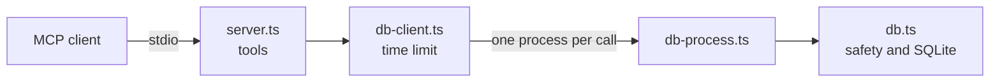

# mcp-sql-analyst

[](https://github.com/tuliovargasrj/mcp-sql-analyst/actions/workflows/ci.yml)
[](LICENSE)

A read-only [Model Context Protocol](https://modelcontextprotocol.io) server that lets an AI assistant explore and query a SQLite database safely.

Connect it to an MCP client such as Claude Code, then ask questions in plain language. The assistant inspects the schema and writes the SQL. The server decides what is allowed to run.

## Why it exists

Giving an LLM database access is useful and risky. A generated query can modify data, read other files, or run forever. This server treats every query as untrusted input and enforces its limits below the model, so safety never depends on the model behaving well.

## What it looks like

These results come from a real Claude Code session using the sample database.

> Which three product categories earned the most from delivered orders in 2025?

The assistant reads the schema first, then writes its own query:

```text
list_tables
describe_table  orders
describe_table  order_items
describe_table  products
run_query       SELECT p.category, ROUND(SUM(oi.quantity * p.price), 2) AS revenue ...
```

| Category | Revenue |
|----------|---------|
| Sports | 108,052.38 |
| Toys | 89,742.04 |
| Kitchen | 66,980.56 |

When the same assistant was told to run unsafe SQL word for word, the server refused:

| Attempt | Server response |
|---------|-----------------|
| `DELETE FROM orders` | `Rejected: only read-only SELECT statements are allowed.` |
| `ATTACH DATABASE 'data/sample.db' AS other` | `Rejected: only read-only SELECT statements are allowed.` |
| A recursive query that never ends | `Query stopped: exceeded 5000 ms.` |

## Quick start

Requires Node.js 24.10 or later. No API key is needed.

```bash
git clone https://github.com/tuliovargasrj/mcp-sql-analyst.git
cd mcp-sql-analyst
npm ci
npm run seed
```

`npm run seed` creates `data/sample.db`, a fictional store with customers, products, and orders.

### Try it without an AI client

```bash
npx @modelcontextprotocol/inspector --cli node dist/index.js data/sample.db --method tools/list
```

```bash
npx @modelcontextprotocol/inspector --cli node dist/index.js data/sample.db --method tools/call --tool-name run_query --tool-arg "sql=DELETE FROM orders"
```

The second command prints `Rejected: only read-only SELECT statements are allowed.` and exits with a non-zero code, because the Inspector treats a tool error as a failure.

### Use it with Claude Code

After the quick start, run `claude` from this folder. It finds the included `.mcp.json` and offers to enable the server. Then ask:

> Which three product categories earned the most from delivered orders in 2025?

### Use your own database

Point any MCP client at the built server:

```json
{
  "mcpServers": {
    "sql-analyst": {
      "command": "node",
      "args": ["/absolute/path/to/dist/index.js", "/absolute/path/to/your.db"]
    }
  }
}
```

## Tools

| Tool | Purpose |
|------|---------|
| `list_tables` | List tables and views, with row counts for tables |
| `describe_table` | Show columns, foreign keys, and three sample rows |
| `run_query` | Run one read-only `SELECT` with row, size, and time limits |

`run_query` returns rows as arrays aligned with `columns`, so a join that repeats a column name keeps both values:

```json
{ "columns": ["id", "id"], "rows": [[31, 1]], "truncated": false }
```

## How the safety model works

All three tools share the same controls, because they all run through the same connection and process.

| Risk | Control |
|------|---------|
| Writing or deleting data | The connection is opened read-only |
| `ATTACH` to read other files, `PRAGMA`, schema changes | A SQLite authorizer allows only reads, functions, recursive queries, and the two schema pragmas `table_info` and `foreign_key_list` |
| Runaway queries | Each operation runs in a disposable process that is killed after 5 seconds |
| A query outliving the server | The server kills any running database process when it stops |
| Oversized queries | SQL longer than 10,000 characters is rejected before it reaches SQLite |
| Oversized results | Limits of 200 rows, 2,000 characters per cell, and 100,000 characters per result |
| A second statement being silently dropped | Anything after the first statement is rejected, including a trailing comment |

### Design decisions

**Authorization happens inside SQLite, not with a text filter.** Filtering SQL strings for words like `DELETE` is easy to bypass. SQLite's authorizer sees the compiled statement, so it does not depend on how the query was written.

**Queries run in a process, not a worker thread.** The first design used a worker thread. A test showed that `node:sqlite` blocks inside native code, so `worker.terminate()` never finished and the program could not exit. Killing a process is reliable, at the cost of starting one for each call.

**Two layers cover writes.** The read-only connection and the authorizer each block writes alone, and the tests check each one with the other removed.

## Testing

```bash
npm test
npm run lint
```

The 43 tests run a real server over stdio through the MCP client SDK. They cover write attempts, `ATTACH`, multiple statements, oversized queries and results, runaway queries, and a database process that fails to start. CI runs them on Ubuntu and Windows.

A safety control only counts if removing it breaks a test, so each one was disabled in turn to confirm that a test fails. That covered 30 changes across the server. Three of them fail only on Linux: they kill a running query when the server stops, and on Windows the child process did not outlive the server even without them.

## Architecture



| File | Responsibility |
|------|----------------|
| [`src/index.ts`](src/index.ts) | Command-line entry point |
| [`src/server.ts`](src/server.ts) | MCP tool definitions |
| [`src/db-client.ts`](src/db-client.ts) | Starts the database process and enforces the time limit |
| [`src/db-process.ts`](src/db-process.ts) | Entry point of the database process |
| [`src/db.ts`](src/db.ts) | Read-only connection, authorizer, and queries |
| [`src/db-protocol.ts`](src/db-protocol.ts) | Messages between the two processes |
| [`src/limits.ts`](src/limits.ts) | All limits in one place |
| [`src/seed.ts`](src/seed.ts) | Sample database generator |

## Limitations

- SQLite only, by design.
- It limits what a query can do, not what it can see: any table in the database can be read, so do not connect a database holding data the AI client should not receive.
- The database process is not an operating system sandbox. Its protection comes from the read-only connection and the authorizer.
- Peak memory is bounded only by the time limit, because `node:sqlite` has no memory cap. A query that builds a very large value can use significant memory for up to 5 seconds.
- On Linux, a server killed with `SIGKILL` cannot stop its running query, which keeps running until it is killed by hand. A normal stop is handled.
- SQL error messages from SQLite are returned to the client. They can mention table and column names, which the client can already read.

## Roadmap

- Allow only selected tables or columns
- Expose the schema as an MCP resource
- Add an optional audit log of executed queries

## License

MIT
